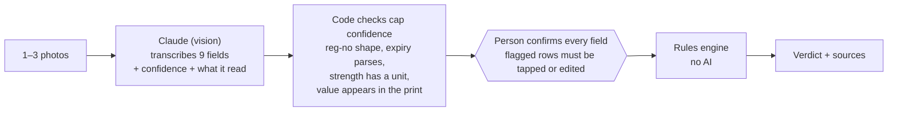

# AI use and validation

HackOHI/O's AI for Impact criteria ask for transparency about how AI is used, validation of its outputs, and human ownership of decisions. This page answers all three for the **product** and for **how we built it**, including what we did not measure.

## 1. In the product: AI reads, people confirm, code decides

| Step | Who | What stops a mistake |
|---|---|---|
| Read the pack | **AI** (Claude, through `/api/extract`) | It only transcribes. It returns what it saw (`sourceText`) beside each value. A reg. no. that doesn't look complete is sent as empty, never guessed. |
| Score the read | **Code** | Confidence = min(the AI's estimate, code checks). A reg. no. or batch under 0.9 is highlighted. |
| Confirm | **The person** | The backend refuses input without `confirmedByUser: true`. Flagged rows need "Looks right" or an edit; any edit un-ticks the confirmation. |
| Decide the verdict | **Code** | Deterministic rules over NAFDAC's data ([verdict rules](planning/02-verdict-rules.md)). No model call. |
| Write the explanation and the report | **Code** | Reasons and the NAFDAC report draft are template text. `/api/report` re-runs the check rather than trusting what the client sent. |
| Send the report | **The person** | MedCheck drafts it; the person sends the email or makes the call. |

If the AI is down, out of budget, or not configured, the typed path does the same check with no AI at all.

**Privacy and cost.** Photos are rotated, stripped of all metadata (including GPS), resized, and never stored. About $0.025 a photo, with a spend guard and a per-IP hourly cap against the team's $40 budget.

## 2. What we validated, and how

| What | How | Result | Caveat |
|---|---|---|---|
| **The rules** | 219 server tests (we ran `npm test` on 404a699: 4 files, all pass) | Pass | |
| The rules on the real registry | Every Active Greenbook row (6,186) fed back in as a genuine pack | 0 false mismatches, 0 false "inactive" | After the shared-number fix |
| The rules against fakes | ~102k genuine variants and made-up fakes generated from the registry | Realistic genuine variants all GREEN; fakes wrongly GREEN fell from 11,500 to 37 | 37 known edge cases remain |
| **The AI read** | 33 test pack photos with ground truth ([`server/testImg/ground-truth.json`](../server/testImg/ground-truth.json)): 8 clean, 11 verdict cases, 14 hard (glare, blur, torn, thumb over the number, two packs, rotated, WhatsApp-compressed…) | First run: 31/33 correct verdicts, **0 field mistakes that weren't flagged**. Both misses were a partial reg. no. reaching "not registered". After the fix: **33/33**, and correct fields wrongly flagged fell from 40 to 6 | **The 33 photos are AI-generated mock packs**, fictional by design (each prints "SPECIMEN - FICTIONAL TEST PACK"). They are not real medicines or real photos. |
| The AI read on real packs | Planned: 10–15 real packs, "reg. no. read correctly N/15" | **Not done.** We have one real pack set (Eric's 3 photos of Natrilix SR, AMBER in the demo), which is a demo, not a scored accuracy run | We don't claim a real-world accuracy number |

## 3. What we tell the user, and what we don't say

- Green always says **"Not proof of authenticity"**, and the ⓘ explains why: we check printed details against records; we can't see the tablets, the seal, or what's inside.
- The app never says "genuine", "authentic" or "safe".
- Every result shows the data dates ("Registry snapshot: 25 Oct 2026 · Last NAFDAC alert: 19 Aug 2026") and never calls the data live.

## 4. How we used AI to build it

| Tool | Used for | How we checked it |
|---|---|---|
| Claude Code (research run) | 6 research agents + 6 adversarial 4-member councils: 54 subagents, ~3.25M tokens, ~16 minutes | Every dataset had to be fetched, not remembered; each council's Skeptic re-fetched the data live. The humans made the pick. See [research method](research/02-method-and-options.md). |
| Claude Code (build) | Most of the code, tests, the design system, the media pipeline, these docs | Tests on every rule change, runs over the real registry, real-browser end-to-end runs, design and accessibility audits. Eric reviewed and steered every change, and rejected several (the v1 design, the guided photo shots). |
| Muse (Meta AI) | The team's shared build file, a demo site, decks, devil's-advocate reviews | Its review caught a deck claiming the hero pack's strength mismatched (it matches), a script that would have needed 414 words a minute (cut to about 429 words for 3 minutes), and two plans that disagreed on cut order. |
| Claude (vision) in the product | Reading pack photos | Section 2 above |

**What AI got wrong, and we caught:**

- The research's flood hook ("Niger at Lokoja rising 45%") was the normal seasonal level. Caught by the council Skeptic re-fetching the data.
- The research first wrote the UNODC figure as "up to 500,000 deaths"; the source says "almost half a million". Caught when we opened the source for the pitch.
- Our own early docs called "not in our snapshot" RED. A real pack proved the snapshot is incomplete; now AMBER.
- A theme commit landed on `main` from feedback meant for another agent; reverted a minute later.
- Timings in the research report said "about 25 minutes"; the commits say 16. We use the commit times.

**What a person decided:** the problem (MedCheck over the Ebola Rumour Desk and the Season Planner), the graded verdict, the design bar and the redesign, removing the guided photo shots, making "not found" amber, renaming the fake hero pack so no real company appears on it, and keeping a single real-photo demo.

## 5. Disclosed stand-ins

- The media library and screen recordings were made on a machine with no AI key, so `/api/extract` there was a stand-in that returned a person's transcription of the pack. The rules, verdicts and screens are the real app.
- The hardening tests ran the real upload, image and parsing code against a local stub of the AI API for the same reason.
