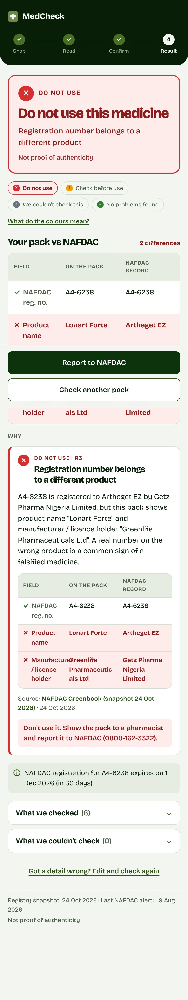
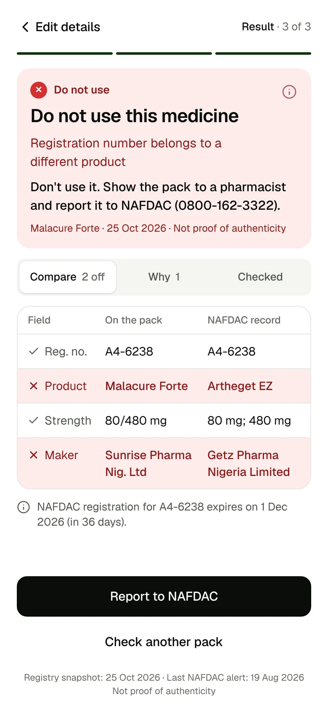
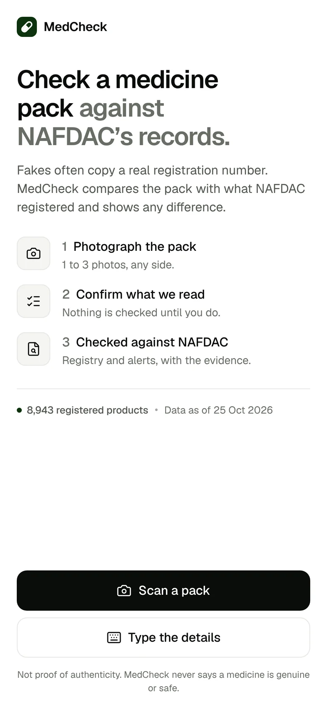
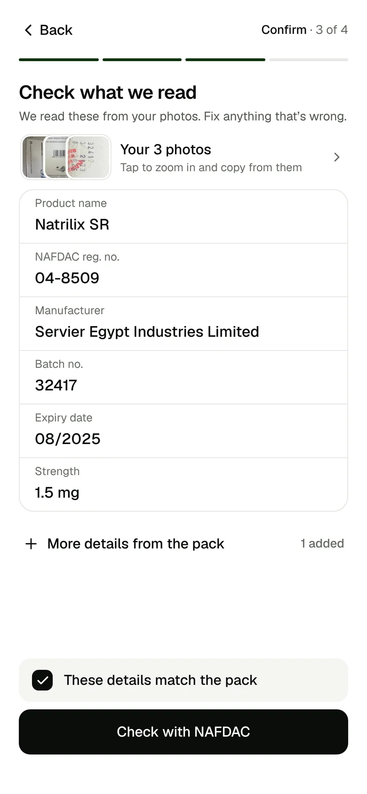
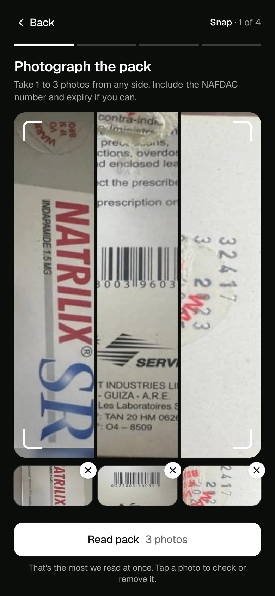
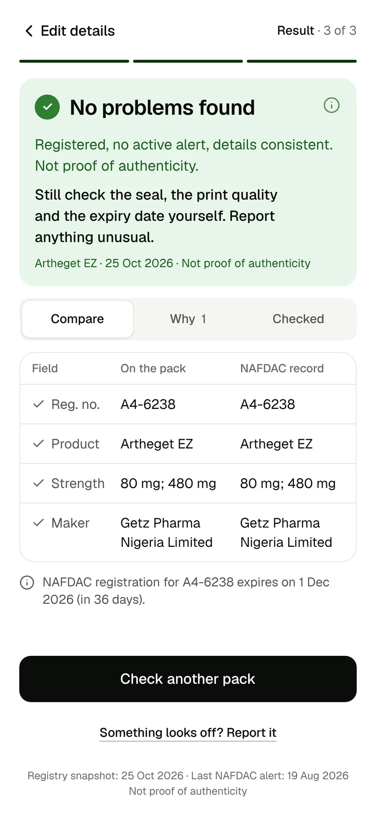
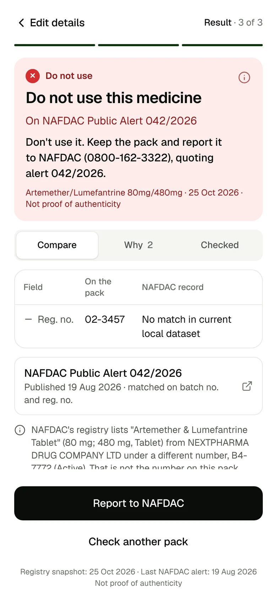
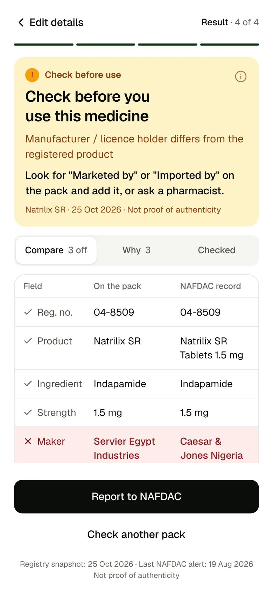
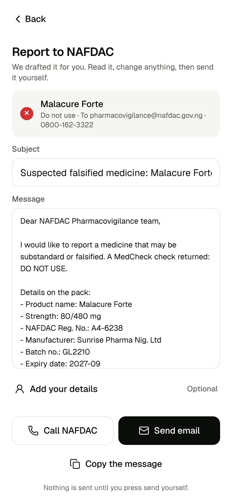

# Design system (v2)

The client was designed twice in one night. v1 (8:04 PM) was rejected within minutes as looking "vibecoded"; v2 (8:29 PM) is what shipped. The story is in [decisions](decisions.md); this page is the system itself. Tokens live in [`client/src/index.css`](../../client/src/index.css), verdict colours in [`shared/legend.ts`](../../shared/legend.ts).

**The bar Eric set:** Apple, Figma, Resend, Railway. A clean health-startup look, built from real product references, "mostly white and black with green accents".

| v1 (rejected) | v2 (shipped) |
|---|---|
|  |  |

## 1. Four principles

1. **One screen, one job.** Each step fits a 390 × 844 phone with no inner scrolling. Detail that doesn't fit goes behind a tab or a sheet.
2. **Always know where you are.** A stepper: Snap · Read · Confirm · Result on the photo path, Type · Check · Result on the typed path.
3. **Colour means something.** The UI is black, white and grey. Colour is reserved for verdicts, plus one brand green for the logo, progress and focus. A button is never green, so it never reads as an all-clear.
4. **Detail on demand.** The verdict and the side-by-side comparison come first; reasons, what was checked and sources sit in tabs ("Compare", "Why", "Checked").

## 2. Colour

| Token | Value | Use |
|---|---|---|
| ink | `#0A0C0A` | Text, primary buttons, the capture stage |
| ink-2 | `#52574F` | Secondary text |
| ink-3 | `#686D65` | Tertiary text, placeholders. Was `#858A82`; darkened after the design audit to reach 4.6:1 or better on every surface |
| line | `#E7E8E5` | Hairlines |
| fill | `#F5F5F3` | Grouped backgrounds |
| surface | `#FFFFFF` | Cards, inputs |
| brand | `#0D330E` | Pakistan Green: logo, progress, focus only |

**Verdict colours** (solid / tint / text), never retyped in the client:

| | Solid | Tint | Text |
|---|---|---|---|
| Red, Do not use | `#D32F2F` | `#FDECEA` | `#8E1B1B` |
| Amber, Check before use | `#F59E0B` | `#FEF3C7` | `#92400E` |
| Grey, We couldn't check this | `#6B7280` | `#F3F4F6` | `#374151` |
| Green, No problems found | `#2E7D32` | `#E8F5E9` | `#1B5E20` |

Solid colours are only for icons, borders and chips. Text always uses the tier's text colour on its tint; amber never carries white text (about 2.1:1).

## 3. Type, shape, depth, motion

- **Type:** Geist (variable), weights 400 / 500 / 600. Scale: display 28/34, title 20/26, body 15/22, foot 13/18, caption 12/16, with slight negative tracking on the large sizes. Reg. numbers and batch codes in monospace.
- **Radii:** 8 / 12 / 16 / 24.
- **Depth:** hairlines, not shadows, for cards and rows. Shadows only where something floats: tabs, sheets, popovers.
- **Motion:** 160 ms, off under `prefers-reduced-motion`.
- **Tap targets:** 44 px minimum.

## 4. Components

shadcn-style components built on **Base UI** primitives, copied into [`client/src/components/ui/`](../../client/src/components/ui/): badge, button, checkbox, input, popover, sheet, tabs, textarea. The verdict card and comparison table live in `verdict.tsx`. This overrode the backend spec's "no heavy UI libraries" rule at Eric's request; Base UI is headless and tree-shaken, and first-load JS ended at 276 KB.

## 5. Screens (final build, 390 × 844)

| Start | Confirm | Three photos |
|---|---|---|
|  |  |  |

| Green: no problems found | Red: cloned number | Red: on a NAFDAC alert |
|---|---|---|
|  |  |  |

| Amber: real Natrilix SR photos | Report to NAFDAC |
|---|---|
|  |  |

These were recorded from the real app and real backend by the media pipeline ([`tools/marketing-media`](../../tools/marketing-media/)). In those recordings `/api/extract` was a disclosed stand-in (a human transcription of the pack), because the build machine had no AI key; the verdicts are real.

## 6. Audits

| Check | Result |
|---|---|
| Impeccable design audit | Findings fixed in f916a13 (8:37 PM), including the ink-3 contrast; 0 issues after |
| Lighthouse, mobile | Accessibility 100, Best practices 100, Performance ~80 (the local server doesn't gzip) |
| First-load JS | 445 KB → 276 KB after the audit fixes |
