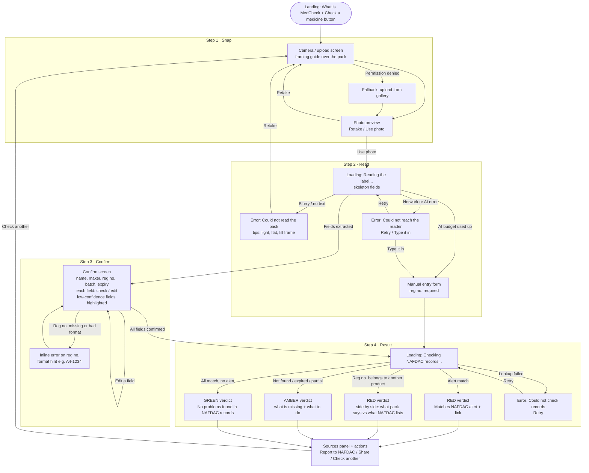
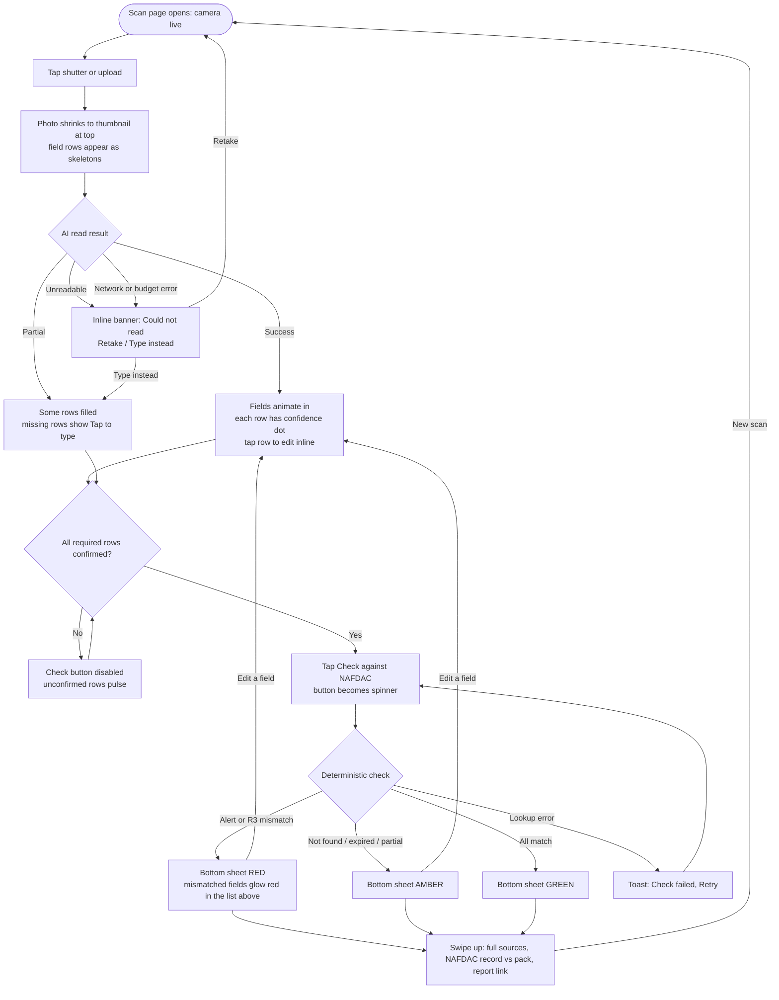
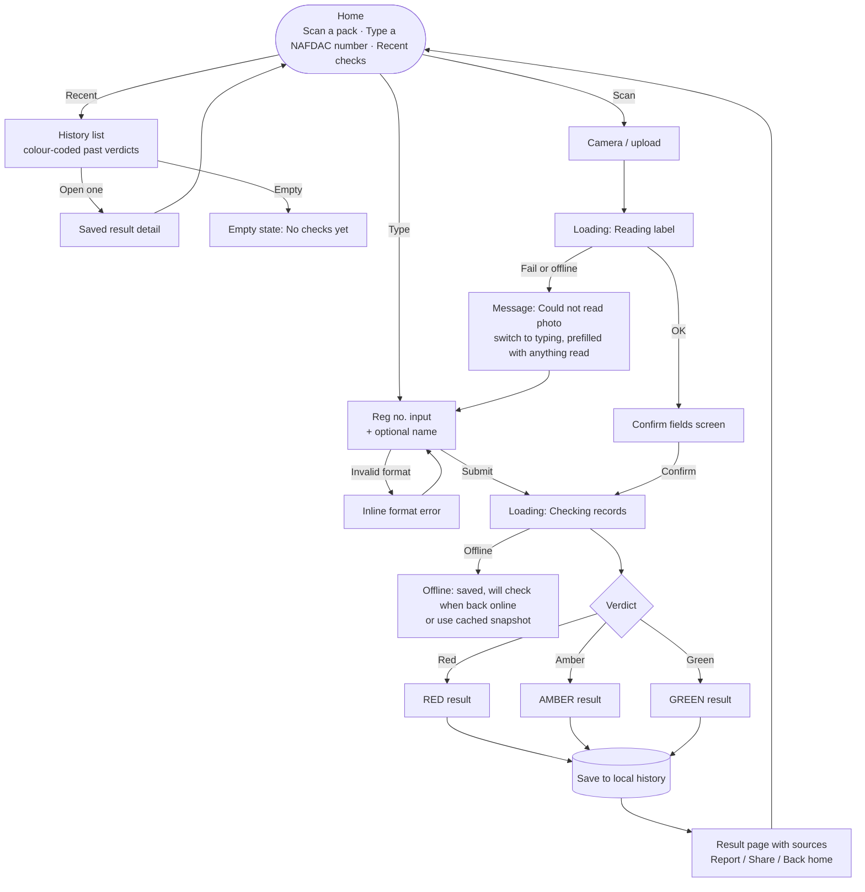
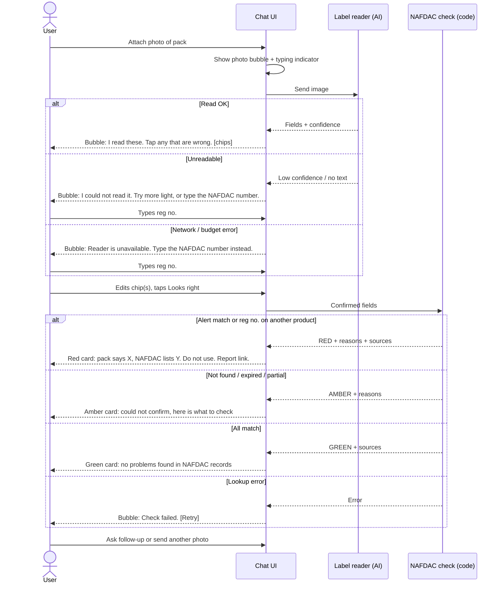
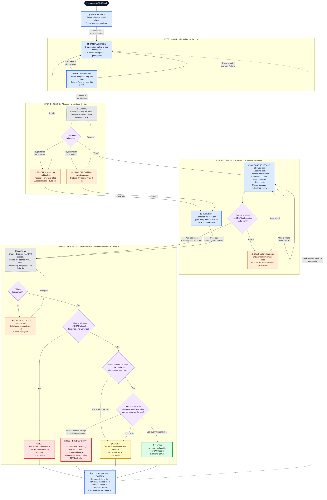
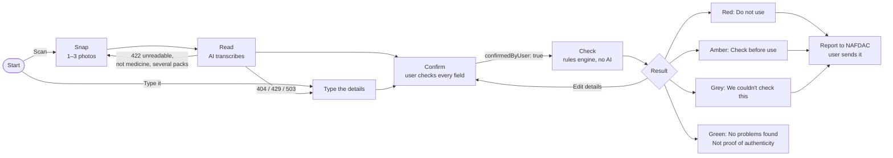

# User flows: the four we drew, how we scored them, and what we built

Written Sat 24 Oct 2026, about 7:15 PM ET, before any client code existed, so the frontend could pick one flow with the team. It is kept here as it was then, with one correction note per section. **What we finally built is at the end.**

> **Correction (later the same night).** These diagrams use 3 verdict colours and say "reg no. not in the snapshot = amber". The backend spec landed minutes later with **4 tiers** (adding grey "We couldn't check this") and made "not found" **red**. We followed the spec ([spec reconciliation](03-spec-reconciliation.md)). At 9:52 PM we changed "not found" back to **amber**, because a real pack (AquaMal QS, B4-0910) was missing from the snapshot ([process log](../process-log.md#952-pm-r1-red-to-amber)).

Four flows for the same core loop: **photo → AI reads label → user confirms fields → deterministic check against NAFDAC Greenbook + falsified-medicine alerts → red / amber / green verdict with sources.** The app never says "genuine". Each diagram covers screens, loading states and error paths.

Shared verdict rules (same in every flow, computed by code, never by the AI):

| Verdict | When |
|---|---|
| 🔴 Red | Product matches a NAFDAC falsified-medicine alert, **or** the reg no. exists but belongs to a different product or maker (the hero "R3 mismatch" case) |
| 🟡 Amber | Reg no. not in the snapshot, registration expired, partial field match, or a key field could not be read |
| 🟢 Green | Reg no. found, name and maker match, no alert hit. Copy says "No problems found in NAFDAC records", never "genuine" |

---

## Flow A: Linear 4-step wizard

One screen per step with a progress bar (Snap, Read, Confirm, Result). The easiest to build and the easiest to narrate in a video.

**Pros:** clear mental model, each step is one component, progress bar tells the story on video, error states are isolated per step.
**Cons:** four screens of navigation; feels a little form-like.

---

## Flow B: Single-screen progressive scan

One page. The photo sits at the top, fields fill in under it as the AI returns, and the verdict card slides up from the bottom. It feels fast and "magic".

**Pros:** most polished feel; the R3 mismatch reads instantly because the wrong field lights up in place; fewest route changes.
**Cons:** more state on one component (scan, extract, confirm, result all live together); animation polish costs time; harder on small screens.

---

## Flow C: Dual entry (scan or type) with history

The home screen offers two equal paths: scan the pack or type the reg no. The idea is to serve low-end phones and poor connections, and to keep a local history of checks.

**Pros:** strongest "real-world Africa" story (low bandwidth, typing fallback), history adds breadth, the typing path is a backup when the AI fails during the demo.
**Cons:** more screens and states to build; typed-only checks skip the photo-vs-registry mismatch, which is the hero moment; offline queue is mostly theatre in a hackathon.

---

## Flow D: Conversational assistant

Chat-style UI. The user sends a photo, the assistant replies with what it read as tappable chips, the user confirms, and the verdict arrives as a rich card.

**Pros:** friendly, familiar (feels like WhatsApp, which is how many users would share it), natural place for follow-up questions.
**Cons:** chat invites free-form AI answers, which blurs the "code decides, not the AI" message judges should hear; free-form follow-ups burn the $40 budget; verdicts are harder to make visually striking inside a chat stream.

---

## Ratings

Scored 1 to 5 for a hackathon demo with ~11 hours left and one frontend dev.

| Criterion | A · Wizard | B · Single screen | C · Dual entry | D · Chat |
|---|:-:|:-:|:-:|:-:|
| Build speed tonight | 5 | 3 | 3 | 3 |
| Demo clarity in a 3-min video | 5 | 4 | 3 | 3 |
| Shows the R3 mismatch hero moment | 4 | 5 | 3 | 4 |
| Shows "user confirms, code decides" | 5 | 4 | 4 | 2 |
| Error-path robustness (survives a live AI failure) | 4 | 3 | 5 | 4 |
| Wow / polish | 3 | 5 | 3 | 4 |
| AI budget safety | 5 | 5 | 5 | 2 |
| **Total (out of 35)** | **31** | **29** | **26** | **22** |

## Recommendation: Flow A (wizard), borrowing two pieces from B and C

Build **Flow A**. It is the fastest to ship, every step maps to a sentence in the video ("snap it, the AI reads it, you confirm it, code checks it"), and the Confirm step makes the human-in-the-loop design obvious to judges.

Two cheap upgrades make it the best of all four:

1. **From B:** on the red mismatch result, show a side-by-side "what the pack says vs what NAFDAC lists" with the mismatched field highlighted. This is the hero shot, so spend polish here.
2. **From C:** the "Type it in" manual path off every read error. It costs one form and means the demo survives a dead AI call or an exhausted budget.

Skip history, the offline queue and chat for now; add history only if there is time after the video is recorded.

Suggested component list for Flow A: `Landing`, `CaptureStep`, `ReadingStep` (loading + errors), `ConfirmStep` (editable field rows with confidence), `ManualEntry`, `ResultStep` (`VerdictBanner`, `MismatchCompare`, `SourcesPanel`, `ActionsBar`), plus a `Stepper` header.

---

## The detailed Flow A diagram (plain language)

Drawn for the whole team, including the non-engineers, after Flow A was chosen. Blue boxes are screens, orange boxes are problems with a way out, diamonds are choices the app makes.

---

## What we actually built (main, Sun 25 Oct)

Flow A survived, with B's side-by-side comparison and C's typed path, as recommended. What changed on the way:

| Plan | Built | Why |
|---|---|---|
| One photo | **1 to 3 photos of one pack, any side, any order** | Packs print the reg no., batch and expiry on different sides. A guided 3-shot sequence (front, NAFDAC no., batch) was built and then removed at Eric's request: it felt like a form. See the [process log](../process-log.md#951-pm-the-photo-flow-reversal). |
| Snap step = file input | Live camera with 7 handled states (prompt, live, denied, no camera, busy, insecure http, tab hidden) plus multi-pick from the photo library | [Hardening pass](04-hardening.md) |
| 3 tiers | 4 tiers from `shared/legend.ts` | Backend spec |
| Per-row ✓ on every field | One "These details match the pack" tick, but low-confidence rows must be tapped ("Looks right") or edited first; any edit un-ticks | Decision 8 in the [design decisions](../design/decisions.md) |
| Stepper Snap · Read · Confirm · Result on every path | Typed path shows Type · Check · Result | UX critique #10: the stepper "lied" on the typed path |
| Report as a mailto link | Report screen: editable draft to NAFDAC, Send email / Call / Share, sent by the user | Backend spec |
| History, offline queue, chat | Not built | Cut as planned |

Screens from the final build are in [design/screens](../design/screens/).
