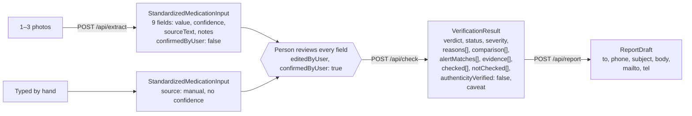

# API contract

The contract is [`shared/types.ts`](../../shared/types.ts), imported by both `server/` and `client/`. The backend wrote it first (7:29 PM); everything else was built against it and against the fixtures in [`shared/fixtures/`](../../shared/fixtures/). This page is a readable summary; the code is the source of truth.

## Endpoints

| Method | Path | In | Out | Errors |
|---|---|---|---|---|
| GET | `/api/health` | | `{ ok: true }` | |
| GET | `/api/meta` | | data dates (`registrySnapshot`, `lastAlert`), registry size, caveat | |
| GET | `/api/legend` | | the 4 tiers, worst first | |
| POST | `/api/extract` | multipart: 1–3 `photos` of one pack (or one `image`) | `StandardizedMedicationInput` (`source: "photo"`, `confirmedByUser: false`) + `extraction` | 404 key not set · 422 unreadable / not medicine / several packs (user-facing message) · 429 spend limit · 503 AI down · 400 / 413 bad or too-large file |
| GET | `/api/extract/status` | | `{ enabled, model, spendUsd, spendLimitUsd }` | |
| POST | `/api/check` | `StandardizedMedicationInput` | `VerificationResult` | 400 `invalid_input` · 422 `unconfirmed` |
| POST | `/api/report` | `{ input, result, reporter?, whereBought?, notes? }` | `ReportDraft` | 400 · 422 if unconfirmed. **Re-runs the check** server-side, so a tampered result can't produce a report |

## The shape in one picture



## Input: `StandardizedMedicationInput`

```ts
interface ExtractedField {
  value: string | null;
  confidence?: number;   // 0–1, photo path only
  sourceText?: string;   // the text the AI read
  notes?: string[];      // why confidence is low, e.g. "changed letter O to digit 0"
  editedByUser: boolean;
}

interface StandardizedMedicationInput {
  source: 'photo' | 'manual';
  fields: {
    productName; strength; nafdacRegNo; manufacturer; batchNo; expiryDate;   // required keys
    activeIngredient?; dosageForm?; marketedBy?;                             // when the pack shows them
  };                                                                         // each an ExtractedField
  confirmedByUser: boolean; // the backend refuses to check unconfirmed input
}
```

`marketedBy` was added at 7:52 PM: NAFDAC registers the Nigerian licence holder, not the foreign factory, so this is what the registry's applicant usually matches.

## Output: `VerificationResult` (abridged)

| Field | What it holds |
|---|---|
| `verdict` | `red` · `amber` · `unsure` · `green` |
| `status` | what the evidence supports: `registry_match_current`, `record_mismatch`, `confirmed_regulatory_alert`, `confirmed_inactive_or_cancelled`, `not_found_in_snapshot`, `lookup_unavailable`, `input_uncertain`, … |
| `severity` | `high` · `warning` · `caution` · `none` |
| `reasons: Finding[]` | every rule that fired, worst first: `rule`, `code` (e.g. `FIELD_MISMATCH`, `NAME_NEAR_MISS`, `REGULATORY_ALERT`), own colour, title, message, evidence rows, source, next step |
| `comparison: ComparisonRow[]` | the side-by-side table: field, on the pack, in the registry, `match: true / false / null` |
| `evidence: EvidenceRecord[]` | every source consulted, **including ones with no record**, with dates and stated limitations |
| `alertMatches` | alert no., title, date, URL, matched on (batch / reg. no. / name) |
| `checked` / `notChecked` | plain lists, e.g. "Batch number (not on pack)" |
| `dataAsOf` | `{ registrySnapshot, lastAlert }`, shown on every result; never "live" |
| `authenticityVerified` | the literal `false` |
| `caveat` | the literal `'Not proof of authenticity'` |

## Extract details that matter

- Photos are auto-rotated, stripped of all metadata (including GPS), resized to 1568 px server-side, and **never stored**. The client first downsizes to 1600 px JPEG for slow connections.
- **Confidence = min(the AI's own estimate, code checks)**: reg. no. shape, expiry parses, strength has a unit, swapped characters, value vs printed text. A partial reg. no. is sent as `value: null` with the `sourceText` and a note, never guessed.
- Fields under 0.9 confidence on the reg. no. or batch are highlighted on Confirm and must be tapped or edited.
- Spend guard (`data/spend.json`) and a per-IP cap (default 30 an hour). About $0.025 per photo.
